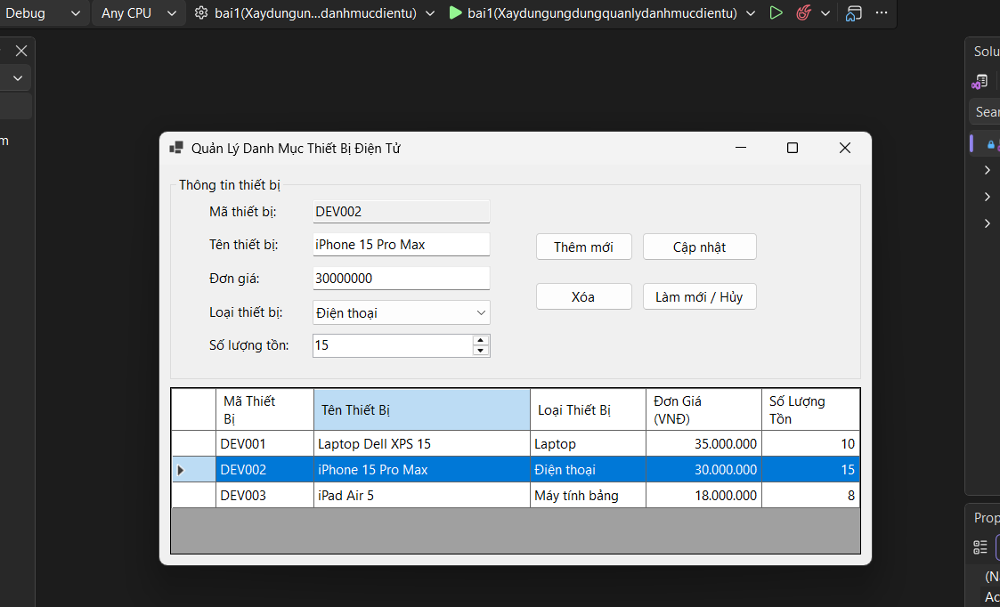
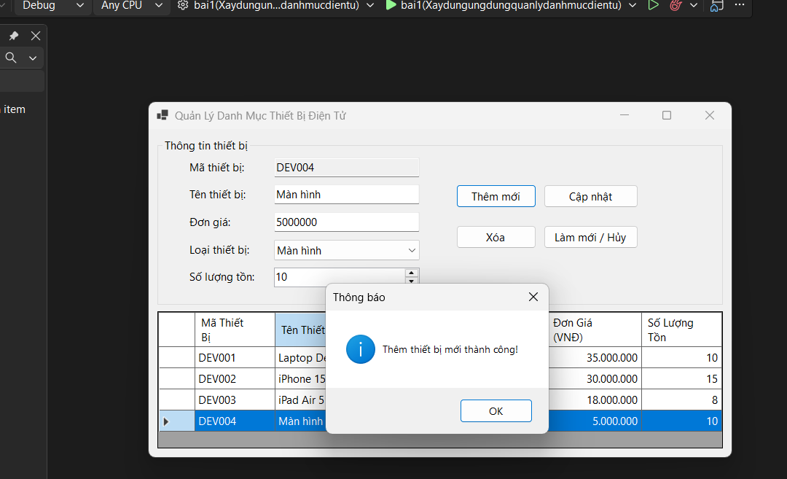
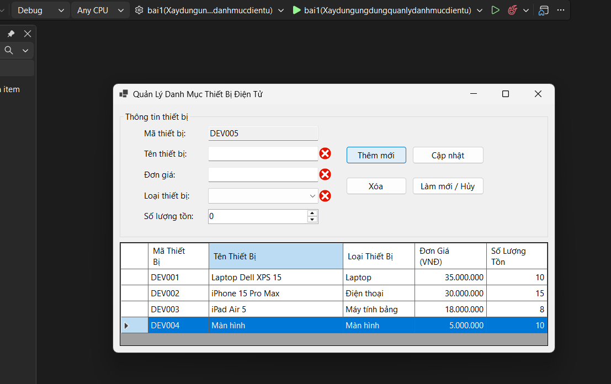
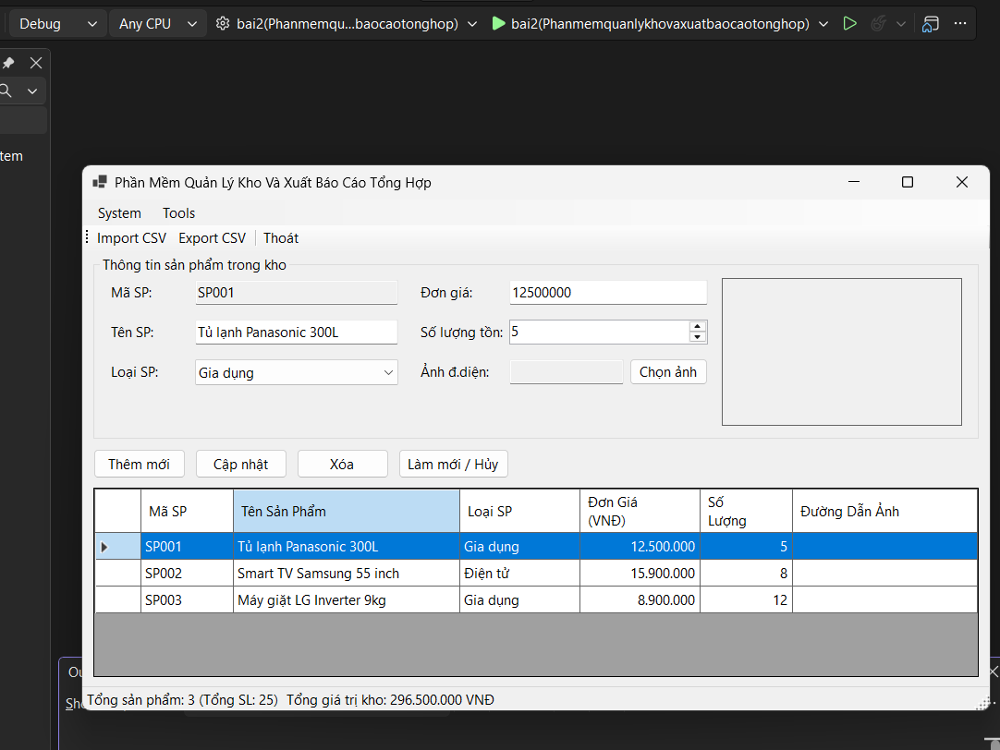
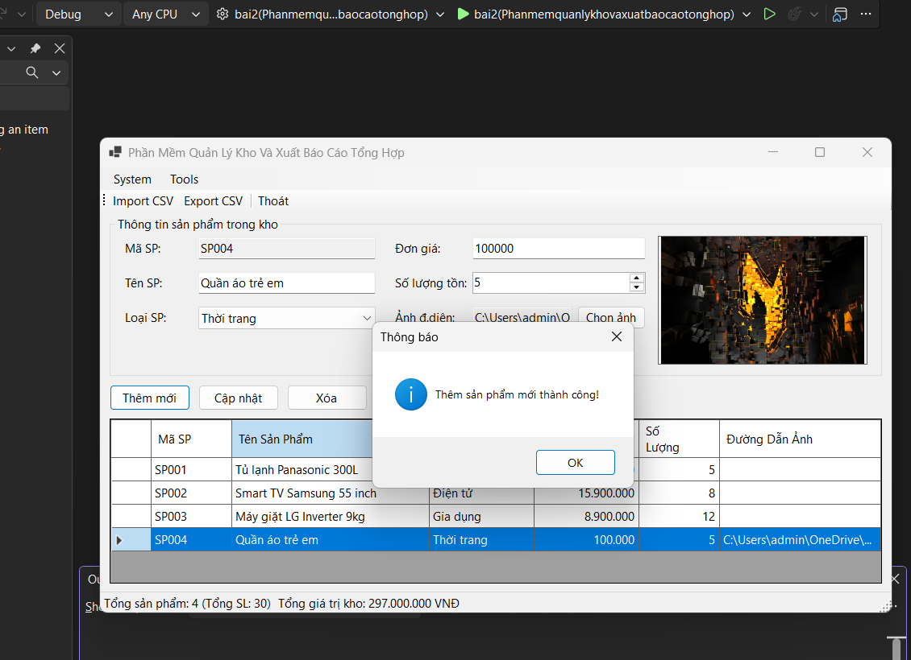
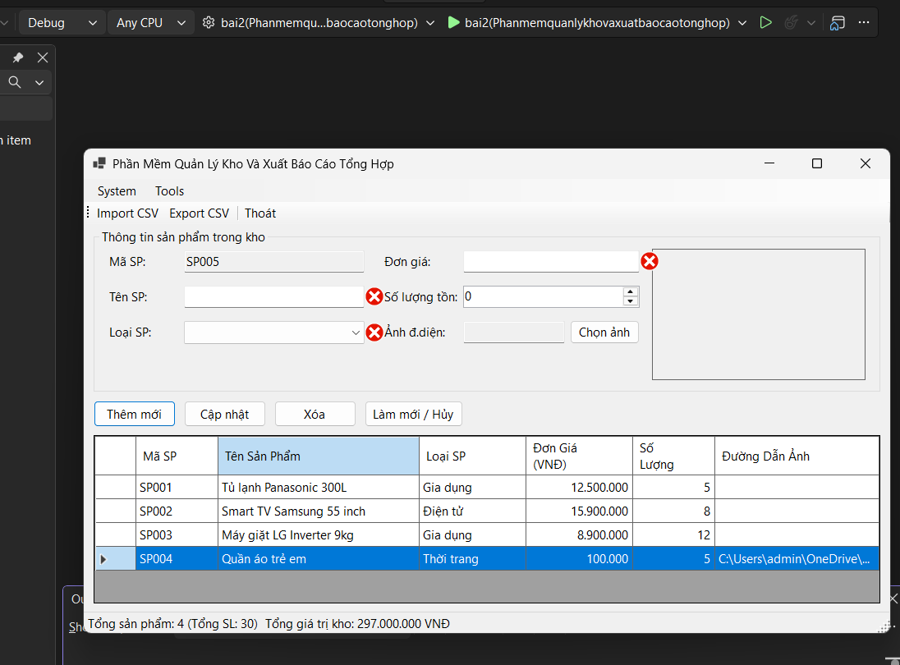
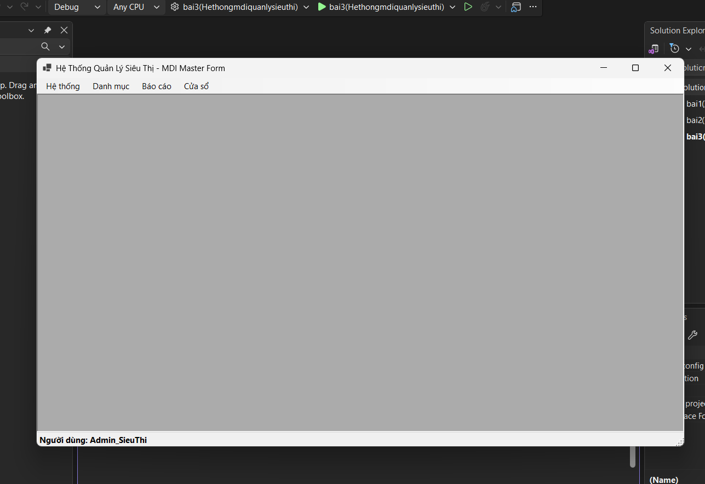
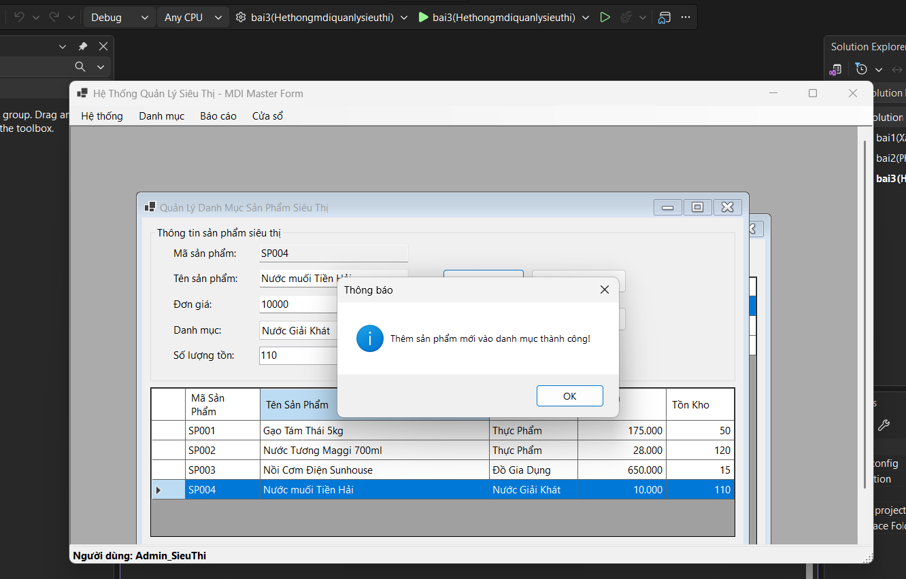
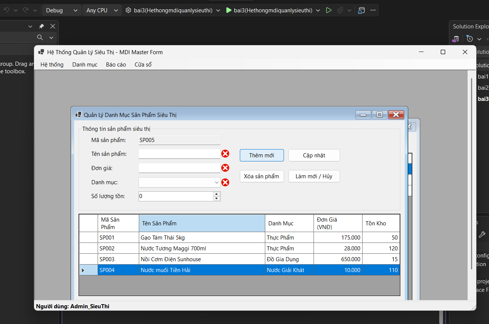

# BÁO CÁO BÀI TẬP

## THÔNG TIN SINH VIÊN
- **Họ và tên:** Phạm Hữu Hưng
- **Mã số sinh viên:** 24810310239
- **Lớp:** D19CNPM3
- **Tên môn học:** Lập trình .NET
- **Tên bài tập:** Bài kiểm tra số 02

---

## KẾT QUẢ THỰC HÀNH

### BÀI 1: XÂY DỰNG ỨNG DỤNG QUẢN LÝ DANH MỤC THIẾT BỊ ĐIỆN TỬ (CƠ BẢN & DATA BINDING)

#### ẢNH GIAO DIỆN MÀN HÌNH CHÍNH

##### ẢNH MÀN HÌNH THỰC THI

---

.png>)

#### ẢNH MÀN HÌNH KIỂM TRA LỖI

---

### BÀI 2: PHẦN MỀM QUẢN LÝ KHO VÀ XUẤT BÁO CÁO TỔNG HỢP (TRUNG CẤP & SYSTEM DIALOGS)

#### ẢNH GIAO DIỆN MÀN HÌNH CHÍNH

##### ẢNH MÀN HÌNH THỰC THI

---

.png>)

#### ẢNH MÀN HÌNH KIỂM TRA LỖI

---

### BÀI 3: HỆ THỐNG MDI QUẢN LÝ SIÊU THỊ & ĐỒNG BỘ DỮ LIỆU BẤT ĐỒNG BỘ (NÂNG CAO - ASYNC/AWAIT & MULTI-THREADING)

#### ẢNH GIAO DIỆN MÀN HÌNH CHÍNH

##### ẢNH MÀN HÌNH THỰC THI

---

.png>)

---

.png>)

#### ẢNH MÀN HÌNH KIỂM TRA LỖI

---
